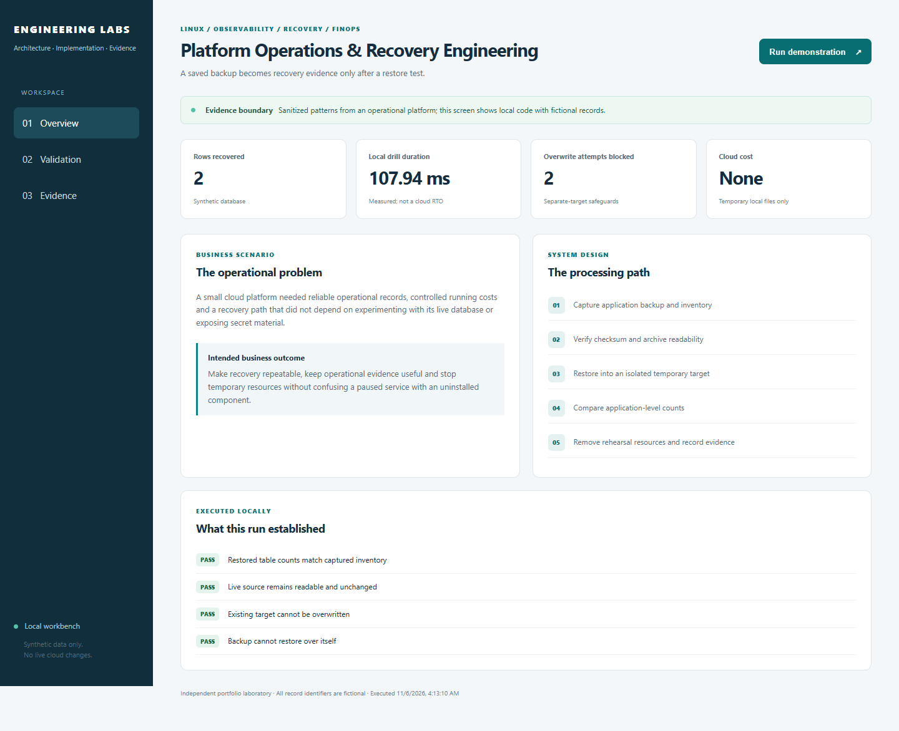
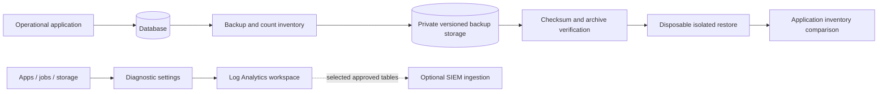
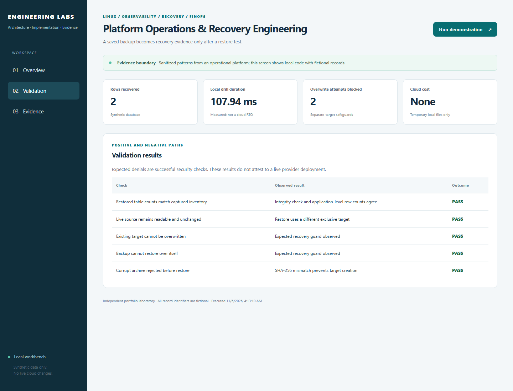

# Platform Operations & Recovery Engineering

**Test recovery, make logs useful and keep temporary cloud resources under control.**

[The problem](#the-business-problem) · [The solution](#the-solution) · [What was built](#what-was-built) · [Proof it works](#proof-it-works) · [Run it](#run-it-locally)



## The Business Problem

The platform needed reliable operating records and a way to recover without experimenting on the live database. It also needed to control running costs and protect private configuration and credentials. A saved backup or a configured log destination was not enough on its own.

## The Solution

Save backups and a record of what they contain, restore them into a separate test environment, and compare the results. Define where logs go and how staff use them to investigate failures. Stop temporary services and confirm their final state after testing.

**Business outcome:** Make recovery repeatable, operating information clearer and temporary-resource cleanup easier to verify.

### Platform implementation

- Operated a Linux-hosted engineering portal with access based on verified sign-in, private runtime material, backups and a tested temporary recovery-host procedure.
- Implemented checksum-verified PostgreSQL backups and disposable network-restore into a separate test environment checks, with database/table/row-count inventory comparison.
- Documented application and infrastructure logs, service diagnostics, Log Analytics queries and the difference between provider acceptance and actual delivery.
- Preserved paused nonproduction states after bounded tests and tracked residual costs, resource ownership and backup/retention requirements.

This case study draws on a workforce/operations platform I designed and implemented. Organization details and records are excluded. The public code makes selected patterns reproducible; the screenshots show a working local demonstration with fictional data. [Validation scope](docs/VALIDATION.md) separates that evidence from testing against the actual cloud service.

### Actual implementation code

This repository now includes selected implementation source and original tests from the operational platform, rather than only a portable reference. Read [what was implemented and accepted](docs/IMPLEMENTATION.md), [the source map](docs/SOURCE-MAP.md) and the dated validation boundaries. Identifying configuration is replaced with examples; original private history and records are excluded.

## Architecture



## What Was Built

| Component | Role in plain words | Implementation |
| --- | --- | --- |
| Actual delivery-status correlation | Match provider, recipient and time without confusing acceptance with delivery | [Reader](reference/deliveryReports.ts) · [original tests](reference/deliveryReports.test.ts) |
| Local recovery reference | Back up a fictional database and restore it into a different exclusive target. | [View code](lab/domain.py) |
| PostgreSQL backup/restore scripts | Preserve the operational checksum, inventory and network-isolated rehearsal pattern. | [View code](scripts) |
| Private backup storage | Use keyless access, versioning and deletion protection. | [View code](infra/storage.tf) |
| Log Analytics and Blob diagnostics | Route audit categories into dedicated storage tables with 30-day operational retention. | [View code](infra/monitoring.tf) |
| Backup lifecycle and optional writer role | Make retention and container-specific access reviewable in code. | [View code](infra/monitoring.tf) |
| Optional recovery-host shell | Define a private-NIC Linux VM with SSH keys; it remains unprovisioned by default. | [View code](infra/recovery-vm.tf) |
| Operational queries | Provide KQL starting points for backup traces and storage authentication. | [View code](queries/operations.kql) |

## Proof It Works

### Extracted platform code

```bash
npm run test:source
```

The selected original tests run offline. [Validation](docs/VALIDATION.md) records current counts and distinguishes them from historical hosted evidence.


**Current local checks:** 12 extracted-source tests + 10 portable tests passed · 5 demonstration checks · 1 Terraform tests using simulated cloud responses.

These are dated results for this reference implementation, not live Azure/AWS deployment claims. [Test record](docs/validation-results.json) · [Evidence and limitations](docs/VALIDATION.md)

### 1. A separate restore matches the saved inventory

The local SQLite rehearsal checks database integrity and compares table/row counts against the source snapshot.

Run from the repository root:

```bash
python -B -m unittest discover -s tests -p test_domain.py -v
```

**What to look for:** The local restore passes integrity and row-count checks using an isolated target.

### 2. Unsafe restore attempts are blocked

A corrupt archive is rejected before creating a target. Existing-target and self-restore attempts cannot overwrite the live database or backup.

Run from the repository root:

```bash
python -B -m unittest discover -s tests -p test_domain.py -k no_ -v
```

**What to look for:** The selected cases reject overwrite/self-restore attempts without modifying the live database.

### 3. Infrastructure defaults are verified

Mock plans keep the recovery VM and writer grant absent by default, and verify versioning, workspace retention and dedicated storage-log table mode. PostgreSQL scripts received syntax checks; these screenshots do not claim a live PostgreSQL/cloud restore.

Run from the repository root:

```bash
terraform -chdir=infra test -filter=tests/recovery.tftest.hcl
```

**What to look for:** The mock plan verifies no recovery VM/writer grant by default, storage protection and dedicated log-table routing.

### 4. Visible results

The dashboard runs the same domain code as the CLI. Desktop/mobile rendering, all three tabs, rerunning the demonstration, cross-origin write rejection and unlisted-file rejection were checked. The screenshots are captured from those runs.



Expected access denials are successful negative tests. Cloud permissions, network connectivity and provider integrations need their own acceptance evidence.

## Security Practices

- The default rehearsal uses fictional local data and a separate target. A checksum proves consistency only when its saved value comes from trusted evidence.
- The optional VM has no public IP and needs a separately reviewed private management route. Enabling it starts billable compute.
- The monitoring root adds operational workspace routing, not Sentinel onboarding or a backup schedule. Log arrival and restore success remain separate observations.

State, saved Terraform plans, private inputs and credentials are excluded through [`.gitignore`](.gitignore). The existing validation workflow is manual-only and has no cloud deployment permission.

## Run It Locally

The [command reference](docs/COMMANDS.md) includes prerequisites, Windows equivalents, focused checks and evidence notes.

Requires Python 3.12 or newer. The default demonstration uses the Python standard library. Run inside a virtual environment:

```bash
python -m venv .venv
source .venv/bin/activate
python -m pip install -r requirements.txt
python -B -m unittest discover -s tests -v
python -B -m lab demo
python -B -m lab serve --port 8011
```

On Windows, use `.venv\Scripts\Activate.ps1` instead of the `source` command, or run `.venv\Scripts\python.exe` directly. Open [the local workbench](http://127.0.0.1:8011), choose **Run demonstration**, then review **Validation** and **Evidence**. Stop with Ctrl+C. No cloud login, employee data or paid API request is required.

## Terraform Infrastructure

An operational Log Analytics workspace, private backup storage, scoped optional backup-writer access, Blob audit routing/retention and an optional private Linux recovery-host shell.

See the [Terraform code and validation steps](infra/README.md), [input example](infra/example.tfvars.example) and [mock plan tests](infra/tests). Cloud commissioning and any paid resources remain separate from the local demonstration.

Validate the infrastructure source without creating cloud resources:

```bash
cd infra
terraform init -backend=false
terraform fmt -check -recursive
terraform validate
terraform test
```

The tests use mock providers. Example inputs are placeholders, not deployment-ready values. Review the [integration boundaries and cost notes](infra/README.md) before any separate cloud commissioning.

## Scaling and Tradeoffs

Assign recovery tiers by business impact, then measure real RPO/RTO against those objectives. Protect encryption-key versions, test isolated recovery and track log ingestion, retention costs and backup age as the platform grows.

See [strengths, weaknesses and tradeoffs](docs/SCALING.md) for the detailed decisions.

## Skills Demonstrated

- Linux and container operations
- Backup integrity and isolated recovery
- Azure Monitor, Log Analytics and KQL
- Storage retention and managed-identity access
- Operational evidence and cloud cost control

## Project Guides

| Guide | What you will find |
| --- | --- |
| [Command reference](docs/COMMANDS.md) | Copy the commands, understand their purpose and check expected results |
| [Implementation walkthrough](docs/WALKTHROUGH.md) | Follow the processing path and code |
| [Architecture](docs/ARCHITECTURE.md) | Understand service and identity boundaries |
| [Terraform](infra/README.md) | Read the resource map, input examples and integration steps |
| [Validation evidence](docs/VALIDATION.md) | Inspect dated checks and their limits |
| [Operations and troubleshooting](docs/OPERATIONS.md) | Diagnose failures and recover safely |
| [Security and privacy](SECURITY.md) | Review access, secrets and publication controls |
| [Scaling and tradeoffs](docs/SCALING.md) | Understand the costs of each design choice |
| [References](docs/REFERENCES.md) | See technical sources and presentation inspiration |

## Repository Map

`reference/` contains extracted implementation logic and original selected tests.


```text
infra/               Terraform source, example inputs and mock plan tests
lab/                 Working reference implementation and loopback dashboard
tests/               Positive, negative and recovery cases
docs/                Architecture, walkthrough, evidence and operating guide
.github/workflows/   Manual-only contract validation; no cloud deployment
```

## Cost and Cleanup

The default local demo creates only temporary local state and makes no paid calls. Cloud examples are separate opt-in source and can create billable resources if an operator applies them. No automated deployment or destruction is configured. Use `git status --short --ignored` before cleanup; remove only your own `.venv` or disposable lab output. Never copy real state files, tokens or employee documents into this repository.
