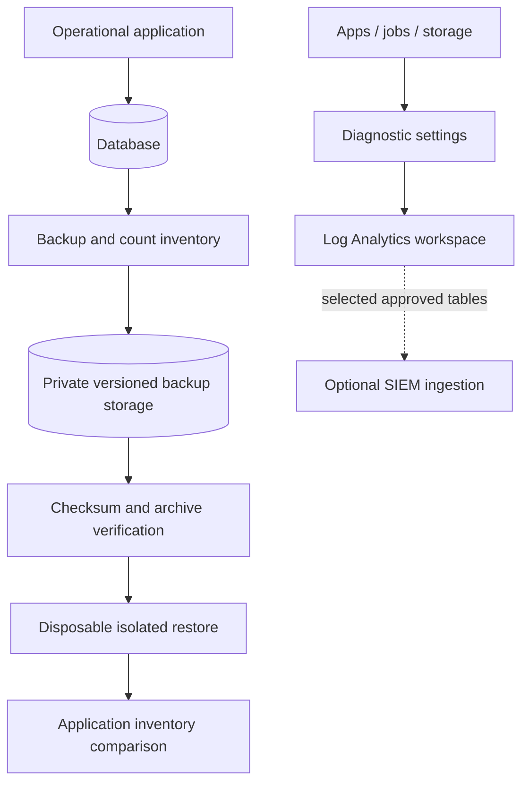

# Architecture and implementation boundaries

**Terms used here:** DNS turns a service name into the network address used to reach it.

## Source-platform context

A small cloud platform needed reliable operational records, controlled running costs and a recovery path that did not depend on experimenting with its live database or exposing secret material.

- Operated a Linux-hosted engineering portal with access based on verified sign-in, private runtime material, backups and a tested temporary recovery-host procedure.
- Implemented checksum-verified PostgreSQL backups and disposable network-restore into a separate test environment checks, with database/table/row-count inventory comparison.
- Documented application and infrastructure logs, service diagnostics, Log Analytics queries and the difference between provider acceptance and actual delivery.
- Preserved paused nonproduction states after bounded tests and tracked residual costs, resource ownership and backup/retention requirements.

## Processing path

## Portable reference boundary

This repository keeps the decision logic small enough to inspect and run. SQLite, temporary files and modeled network decisions replace cloud-side resources where stated. No production identifiers or original employee records are included. The browser dashboard is a loopback-only demonstration, not a hosted multi-user application.

The public implementation borrows the source platform's responsibilities and failure lessons. It does not claim byte-for-byte equality with the Node.js/Azure implementation. Changes of language or backing store are explicitly reference adaptations.

## Trust boundaries

1. Treat user input, scan events and imported files as untrusted data.
2. Validate identity, resource ownership and exact source/version before changing state.
3. Keep privileged workers and deployment identities separate from business API permissions.
4. Preserve failed and unknown outcomes; do not turn absence of evidence into a success.
5. Keep secrets in a managed secret store or local environment, never in Git or screenshots.

## Before a hosted deployment

Review the caller matrix, identity permissions, durable state, concurrency, log redaction and recovery path. Run actual provider integration tests in an isolated environment. Separately review cost, data retention, DNS and rollback. The manual CI validates local contracts only and has no cloud identity or deployment permission.

## Included Terraform

An operational Log Analytics workspace, private backup storage, scoped optional backup-writer access, Blob audit routing/retention and an optional private Linux recovery-host shell. See [the code map, resource inventory and integration boundaries](../infra/README.md). This public root does not provision every box in the application diagram.

## Implementation evidence

[The platform-specific implementation](IMPLEMENTATION.md) records the real service boundaries and historical acceptance. Public adapters omit credentials and use fictional dependencies; a passing local test is not a live permission or network acceptance receipt.
